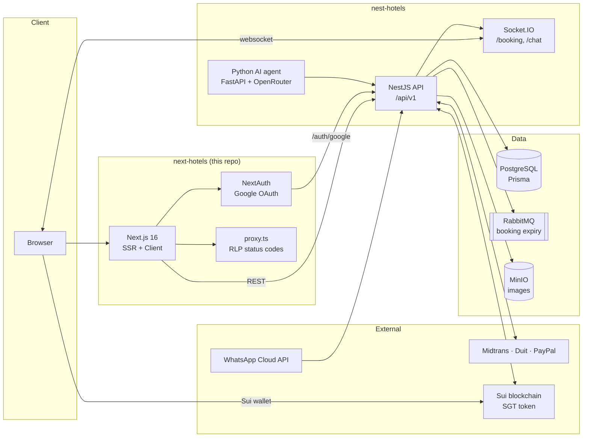
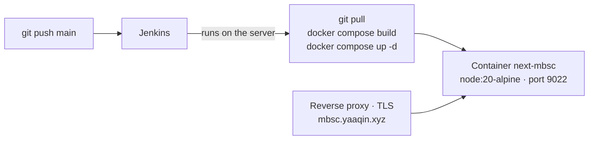

<div align="center">

# 🏨 Next Hotels

### Book direct. Pay your way. Run every branch from one place.

The web platform for a multi-branch hotel group: a direct-booking site for guests, an operations dashboard for hotel staff, and a partner portal for in-house restaurants.

[](https://nextjs.org)
[](https://react.dev)
[](https://www.typescriptlang.org)
[](https://tailwindcss.com)
[](https://sui.io)

🌐 **[Live → mbsc.yaaqin.xyz](https://mbsc.yaaqin.xyz)**

</div>

---

# Part 1 — Product & Business

## 🎯 What is Next Hotels?

Next Hotels is the frontend of a hotel platform built for a group that runs **several hotel branches**. It replaces third-party booking channels with a **direct booking site** the group owns, and gives staff one dashboard to run rooms, prices, bookings, and partner restaurants across every branch.

Three things make it more than a booking form:

- **Guests pay the way they want.** Indonesian bank transfer (Virtual Account), QRIS, PayPal for international guests, crypto (SGT token on Sui), or stored booking credit.
- **Prices are managed, not typed.** Prices come from approved proposals per branch, can be adjusted per room and per night, and are shown in the guest's own currency.
- **Guests are found and kept.** SEO landing pages bring guests in from Google; news, food ordering, an AI booking assistant, and guest-to-guest chat keep them engaged after booking.

## 👥 Who uses it

| User | What they do here |
|---|---|
| **Guest** | Finds a room, books and pays, manages the stay (check-in/out, reschedule, cancel & refund), orders food, chats |
| **Hotel admin / manager** | Runs daily operations, rooms and room types, pricing, refunds, maintenance, finance reports |
| **Owner / Superadmin** | Approves prices and price changes, sets exchange rates, sees all branches |
| **System admin (DEV / SUPERADMIN)** | Manages roles, admin accounts, dashboard menus, and access control in the Config Panel |
| **Article admin** | Writes and schedules news articles in the Newsroom |
| **Restaurant partner** (owner, manager, kitchen, cashier) | Manages menus, products, branches, and staff; receives guest food orders |

## ✨ What the platform does

### For guests
- 🔎 **Find a room**: browse by branch, city, room type, or promo on fast, Google-indexed listing pages; filter by facilities or search in plain words (typo-tolerant, multi-language).
- 🛏️ **Book one or more rooms**: pick exact room numbers, see the price per night, and book several rooms for the same dates in one go.
- 💳 **Pay your way**:
  - Virtual Account: BCA, BNI, BRI, Mandiri, Duit.
  - QRIS: Midtrans or Duit.
  - **PayPal**: charged in USD, converted from the Rupiah total at the current rate.
  - **Crypto**: SGT token on the Sui blockchain.
  - **Booking credit**: stored balance from earlier refunds.
- ⏱️ **Live payment status**: the reservation page turns "paid" by itself the moment payment lands. Unpaid bookings expire after 15 minutes and release the room.
- 🌍 **Your language, your currency**: Indonesian, English, Japanese, Chinese; prices shown in IDR, USD, SGD, JPY, or CNY.
- 🧳 **Manage the stay**: recent activity with a *Pay Now* shortcut for pending bookings, self check-in/out, reschedule (pay the price difference if any), cancel with a refund preview, refund as cash or credit, and withdraw credit to SGT.
- 🍽️ **Order food** from partner restaurants at the hotel and pay online.
- 🤖 **Book via AI assistant**: chat widget on the site and WhatsApp, able to check rooms and create bookings.
- 💬 **Guest chat**: claim a unique username, then send direct messages to other guests in real time, with read receipts.
- 📰 **News**: hotel news and articles.

### For hotel operations
- 🏢 **Multi-branch**: each branch (site) has its own rooms, prices, and staff. Branch admins are locked to their own branch.
- 🛏️ **Rooms & room types**: room types with photos, facilities, and multi-language descriptions; physical rooms per floor; room plan view.
- 💰 **Pricing control**:
  - Price proposals per branch and period, with weekend, special-date, and range rules, approved by an owner.
  - **Price adjustments** per room type or per room on top of approved prices.
  - A price calendar comparing the proposal against the adjusted price.
- 💱 **Exchange rates**: updated automatically every day; the head office can lock a rate manually.
- 🧾 **Front desk**: confirm bookings, today's arrivals and due check-outs, and a booking list with guest contacts.
- 🔁 **Policies**: refund and reschedule policies (including same-day rules) configurable per branch.
- 🔧 **Room maintenance**: request → review → start → complete.
- 📊 **Finance**: daily metrics, revenue, occupancy, and paid bookings per method, with Excel export.
- ⚙️ **Payment methods on/off** per branch and per use (rooms vs food) in the Config Panel.
- 🔐 **Access control**: roles, admin accounts, and dashboard menus defined in the Config Panel.

### For restaurant partners
- 🍳 **Restaurant dashboard** for owners and staff (manager, kitchen, cashier): menus, products, food categories, branches.
- 🤝 **Partnership & monthly billing** between restaurant and hotel.
- 🧾 **Food orders** from guests, paid online (Midtrans Snap, Duit VA/QRIS).

### For growth
- 🔍 **SEO**: server-rendered listing pages with breadcrumbs, structured data (JSON-LD), canonical URLs, sitemaps, and correct 301/404 status codes. A FAQ per page is generated from real room, price, and payment data.
- 📰 **Newsroom**: draft, publish, or schedule articles; slug changes redirect automatically; analytics on views and likes.

## 🧭 Guest journey (booking)

1. A guest lands on a listing page (`/hotel/...`) from Google or the home page, then opens a room detail page.
2. They pick dates and rooms, then **Reserve**. Google sign-in is required only at this step.
3. They enter contact details, choose a payment method, and confirm.
4. Next step depends on the payment method:
   - **VA / QRIS**: the reservation page shows the VA number or QR code.
   - **PayPal**: the guest is redirected to PayPal and then returns to the site.
   - **Credit / crypto**: payment is settled right away.
5. The page switches to **Paid** in real time. From then on the booking lives in *Recent Activity*: check-in, reschedule, cancel, refund.

## 🗺️ Roadmap

- 💬 **Guest chat entry points**: chat is live at `/chat` (Google sign-in + username). Navigation links and access rules are still to be decided.
- More items are tracked in the internal feature docs (`doc/v1`, `doc/v2`).

---

# Part 2 — Technical & Infrastructure

## 🏗️ System architecture



| Repo | Role |
|---|---|
| **`next-hotels`** (this repo) | Guest website, hotel dashboard, config panel, restaurant dashboard, newsroom |
| [`nest-hotels`](https://github.com/yaaqin/nest-hotels) | REST API, websockets, payment webhooks, cron jobs, queue consumers, AI agent (`agent/`) |

## 🧱 Tech stack

| Category | Technology |
|---|---|
| Framework | Next.js 16 (App Router), React 19 |
| Language | TypeScript 5 |
| Styling | Tailwind CSS v4, shadcn/ui, Radix UI, Framer Motion |
| Server state | TanStack React Query v5, Axios |
| Client state | Zustand (with `localStorage` persistence for the booking form) |
| Tables & charts | TanStack React Table v8, Chart.js, Recharts |
| Auth | NextAuth.js (Google provider), JWT, cookies-next |
| Realtime | Socket.IO client |
| Blockchain | Mysten Sui SDK, Mysten dApp Kit |
| i18n | i18next, react-i18next (`idn`, `eng`, `jpn`, `chn`) |
| Dates | date-fns, react-day-picker |
| Content | marked (article rendering) |
| Icons | Lucide React, HugeIcons |
| Testing | Playwright (e2e), Cypress |
| Delivery | Docker (multi-stage), Docker Compose, Jenkins |

## 🗂️ App areas & routes

| Area | Routes | Who | Auth |
|---|---|---|---|
| Public site | `/`, `/hotel/...`, `/booking/...`, `/news/...`, `/about` | Everyone | — |
| Booking & payment | `/reservation`, `/reservation/[code]`, `/payment/...` | Guest | Google |
| Guest area | `/profile`, `/recent-activity`, `/history`, `/reschedule/[id]` | Guest | Google |
| Food | `/food`, `/food/order/[id]`, `/food/payment` | Guest | Google |
| Chat | `/chat` | Guest with username | Google |
| Hotel dashboard | `/dashboard/*` | Hotel admins (menus follow role access control) | Admin login |
| Config panel | `/config-panel/*` | `DEV`, `SUPERADMIN` | Admin login |
| Newsroom | `/newsroom/*` | `ARTICLE_ADMIN` | Admin login |
| Restaurant | `/restaurant/*` | Restaurant owner & staff | Restaurant login |
| Login | `/login` | Admin & restaurant accounts | — |

## 📁 Project structure

```
next-hotels/
├── src/
│   ├── app/            # App Router routes (see table above), NextAuth route, sitemaps, robots
│   ├── components/
│   │   ├── pages/      # One component per page (route files stay thin)
│   │   ├── organisms/  # Feature blocks (drawers, panels, chat, dashboards)
│   │   └── molecules/  # Smaller shared pieces
│   ├── services/       # Axios calls to the BE, one folder per domain
│   ├── hooks/
│   │   ├── query/      # React Query reads
│   │   ├── mutation/   # React Query writes
│   │   └── custom/     # Socket, payment, session helpers
│   ├── models/         # TypeScript types for API payloads
│   ├── stores/         # Zustand stores (booking form, language, …)
│   ├── i18n/locales/   # idn / eng / jpn / chn translations
│   ├── libs/           # Axios instances, API URLs
│   ├── constans/       # Shared constants (payment providers, …)
│   ├── utils/          # Formatting, cookies, menu helpers
│   └── proxy.ts        # Edge proxy: resolves listing URLs to 301/404 before render
├── components/ui/      # shadcn/ui primitives
├── e2e/                # Playwright tests (admin, public, auth setup)
├── cypress/            # Cypress tests
├── public/             # Static assets
├── Dockerfile · docker-compose.yml · Jenkinsfile
└── next.config.ts
```

## 🔩 Key technical concepts

**Data flow.** Route file → page component → React Query hook → service (Axios) → BE `/api/v1`. Types for every payload live in `src/models`.

**Three Axios instances** (`src/libs/instance.ts`):

| Instance | Used for | Token |
|---|---|---|
| `axiosPublic` | Public endpoints | — |
| `axiosUser` | Guest endpoints | NextAuth session `accessToken` |
| `axiosPrivate` | Admin & restaurant endpoints | `accessToken` cookie, auto-refresh with CSRF token |

**Auth.**
- **Guests** sign in with Google through NextAuth. The NextAuth callback exchanges the Google login for a BE JWT (`/auth/google`) and refreshes it before it expires.
- **Admins and restaurant staff** sign in with username and password. The BE issues a JWT plus a session row that can be revoked.
- **Access:** the BE decides which account type may call each endpoint (`@AllowAccount`). Admin dashboard menus come from role access control (`GET /me/menus`).

**Realtime.** Socket.IO namespaces on the BE host (no `/api/v1` prefix):

| Namespace | Event | Purpose |
|---|---|---|
| `/booking` | `payment:{bookingCode}` | Reservation page flips to paid / expired without reload (plus 5 s polling as a fallback) |
| `/chat` | `chat:message`, `chat:read` | Guest chat. Authenticated with the user JWT in the handshake, one room per user. Messages are sent over REST (idempotent `clientId`) and pushed over the socket. |

**Payments.**
- **Midtrans & Duit (VA / QRIS):** the bill is shown on `/reservation/[code]`.
- **PayPal:** the guest is redirected to PayPal approval. PayPal returns to `?paypal=return`, and the FE calls the capture endpoint. A BE webhook also captures, in case the guest never comes back.
- **SGT:** the guest signs a Sui transfer in their wallet, and the FE sends the transaction digest for verification.
- **Credit:** settled immediately.

All methods are checked against the per-branch on/off settings.

**Pricing & currency.**
- The BE computes the total per night from proposal + rules + adjustments.
- Every charge is in IDR, except PayPal (USD).
- Display currency is a cookie, sent as the `x-currency` header. The rate at booking time is stored as a snapshot.

**i18n.** Language is stored in a cookie, so server-rendered pages (listing, room detail, layout) render in the right language with no hydration flash. Translations live in `src/i18n/locales/*.json`.

**SEO.**
- Listing and room detail pages are server-rendered.
- `proxy.ts` resolves `/hotel/...` paths against the BE before rendering, so aliases return **308/301** and unknown paths return a real **404**. App Router streaming would otherwise send `200` first.
- Sitemaps: `/sitemap.xml`, `/sitemap-pages.xml`.

**Booking form state.** The reservation form lives in a persisted Zustand store (`booking-store` in `localStorage`). `/reservation` sends visitors back to home before rendering when the store has no branch, dates, or room type.

## 🚀 Getting started

### Prerequisites
- Node.js `>= 20`, npm `>= 10`
- A running [`nest-hotels`](https://github.com/yaaqin/nest-hotels) API (local or remote)
- Google OAuth client (for guest sign-in)

### Install & run

```bash
git clone git@github.com:yaaqin/next-hotels.git
cd next-hotels
npm install
# create .env (see Environment variables below)
npm run dev            # http://localhost:9022
```

### Environment variables

| Variable | Side | Description |
|---|---|---|
| `NEXT_PUBLIC_API_BASE_URL` | client + server | BE host **without** `/api/v1`, e.g. `https://mbsc-be.yaaqin.xyz`. REST uses `<host>/api/v1`, sockets use `<host>/<namespace>`. |
| `BE_URL` | server | BE host used by NextAuth to exchange Google login and refresh guest tokens |
| `NEXTAUTH_URL` | server | Public URL of this app, e.g. `http://localhost:9022` |
| `NEXTAUTH_SECRET` | server | NextAuth session encryption secret |
| `CLIENT_ID` / `CLIENT_SECRET` | server | Google OAuth client |
| `NEXT_PUBLIC_SITE_URL` | client + server | Canonical site URL for SEO (default `https://mbsc.yaaqin.xyz`) |
| `NEXT_PUBLIC_MIDTRANS_CLIENT_KEY` | client | Midtrans Snap client key (food payment) |
| `NEXT_PUBLIC_MIDTRANS_IS_PRODUCTION` | client | `true` to load the production Snap script |
| `NEXT_PUBLIC_API_UPLOAD_IMAGE` / `NEXT_PUBLIC_KEY_IMAGE_ACCESS` | client | Image upload endpoint and access key |

> `NEXT_PUBLIC_*` values are inlined at **build time**. Changing them requires a rebuild, not just a restart.

Payment gateway secrets (Midtrans, Duit, PayPal), database, queue, and storage credentials belong to the BE, not this repo.

## 🧪 Testing

| Command | What it does |
|---|---|
| `npm run e2e` | Playwright end-to-end tests (`e2e/admin`, `e2e/public`, with an auth setup step) |
| `npm run e2e:ui` | Playwright in interactive UI mode |
| `npm run e2e:report` | Open the last Playwright HTML report |
| `npx cypress open` | Cypress tests in `cypress/e2e` |
| `npx tsc --noEmit` | Type check |

Interactive elements used by tests carry `data-cy` attributes.

## 🐳 Infrastructure & deployment



- **Image:** multi-stage `Dockerfile` (`deps` → `builder` → `runner` on `node:20-alpine`). The runtime image contains only `.next`, `node_modules`, `public`, and `package.json`. It runs `npm start` on port **9022**.
- **Compose:** a single service `next-app` (container `next-mbsc`), bound to `127.0.0.1:9022` only, so it is reachable through the host's reverse proxy and not directly from the internet. It reads env from `.env` on the server and uses `restart: always`.
- **CI/CD:** the `Jenkinsfile` deploys on the server in `/home/yaaqin/apps/next-hotels` with `git pull origin main` → `docker compose down` → `docker compose build` → `docker compose up -d`. Pushing to `main` is the release.
- **Domains:** frontend at `mbsc.yaaqin.xyz`, API at `mbsc-be.yaaqin.xyz`, images from `cdn.yaaqin.xyz` (allowed in `next.config.ts` together with Google avatars).
- **Backend side** (for reference): NestJS on port 9021 with PostgreSQL, RabbitMQ (15-minute booking expiry queue), MinIO, cron jobs (exchange rates, scheduled articles, billing), and payment webhooks on paths without the `/api/v1` prefix (`/webhook/midtrans`, `/webhook/dpay`, `/webhook/paypal`).

### Run with Docker locally

```bash
docker compose up --build        # uses .env, serves on 127.0.0.1:9022
# or
docker build -t next-hotels . && docker run --env-file .env -p 9022:9022 next-hotels
```

## 🔧 Scripts

| Script | Description |
|---|---|
| `npm run dev` | Dev server on port 9022 |
| `npm run build` | Production build |
| `npm start` | Production server on port 9022 |
| `npm run lint` | ESLint |
| `npm run e2e` / `e2e:ui` / `e2e:report` | Playwright |

## 📚 Documentation

Feature-level documentation (flows, endpoints, status per feature, access rules) is kept in the internal `doc/` folder alongside both repos:

- `doc/v1`: baseline features (auth, booking & payment, operations, refund, restaurant, chatbot, infra, …)
- `doc/v2`: changes since 26 Sep 2026 (listing pages, per-branch pricing, multi-currency, config panel, reschedule, price adjustment, news, PayPal)
- `doc/security`, `doc/seo`, `doc/track-audience`: security findings, SEO, analytics plans

## 📄 License

This project is private and not open for public distribution.

---

<div align="center">

**Built by [yaaqin](https://github.com/yaaqin)**

</div>
